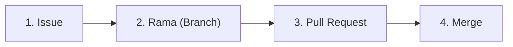

# Guía de Contribución

¡Gracias por tu interés en contribuir al **Conversor de Unidades de Longitud**!

Para mantener un proyecto ordenado y con alta calidad de código, seguimos el flujo de trabajo estándar de GitHub (**GitHub Flow**):



---

## 1. Abrir un Issue (Incidencia)
Antes de enviar código nuevo:
- Ve a la pestaña [Issues](../../issues) del repositorio y pulsa **New issue**.
- Selecciona la plantilla adecuada:
  - **Reporte de fallo (Bug)** para errores detectados.
  - **Propuesta de mejora (Feature Request)** para sugerir cambios o nuevas funciones.

---

## 2. Preparar el cambio en una rama
1. Clona el repositorio si aún no lo has hecho:
   ```bash
   git clone https://github.com/hectorv29/conversor-longitud.git
   cd conversor-longitud
   ```
2. Crea una rama descriptiva a partir de `main`:
   ```bash
   git checkout -b feature/nombre-de-tu-mejora
   # o para un fallo:
   git checkout -b fix/descripcion-del-fallo
   ```
3. Instala las dependencias y realiza tus cambios:
   ```bash
   pip install -r requirements.txt
   ```

---

## 3. Ejecutar las pruebas unitarias
Antes de subir los cambios, asegúrate de que todos los tests pasen satisfactoriamente:
```bash
python -m unittest discover tests -v
```
Si tu cambio añade lógica nueva, añade los tests correspondientes en la carpeta `tests/`.

---

## 4. Crear la Pull Request (PR)
1. Sube tu rama a GitHub:
   ```bash
   git push -u origin feature/nombre-de-tu-mejora
   ```
2. Ve a GitHub y abre una **Pull Request** hacia `main`.
3. En la descripción, vincula el Issue que resuelve utilizando:
   `Closes #<numero-del-issue>` o `Fixes #<numero-del-issue>`.
4. El sistema de integración continua (**GitHub Actions**) validará automáticamente que los tests pasen.
5. Tras la revisión y aprobación, se realizará el **Merge** a la rama principal `main`.
